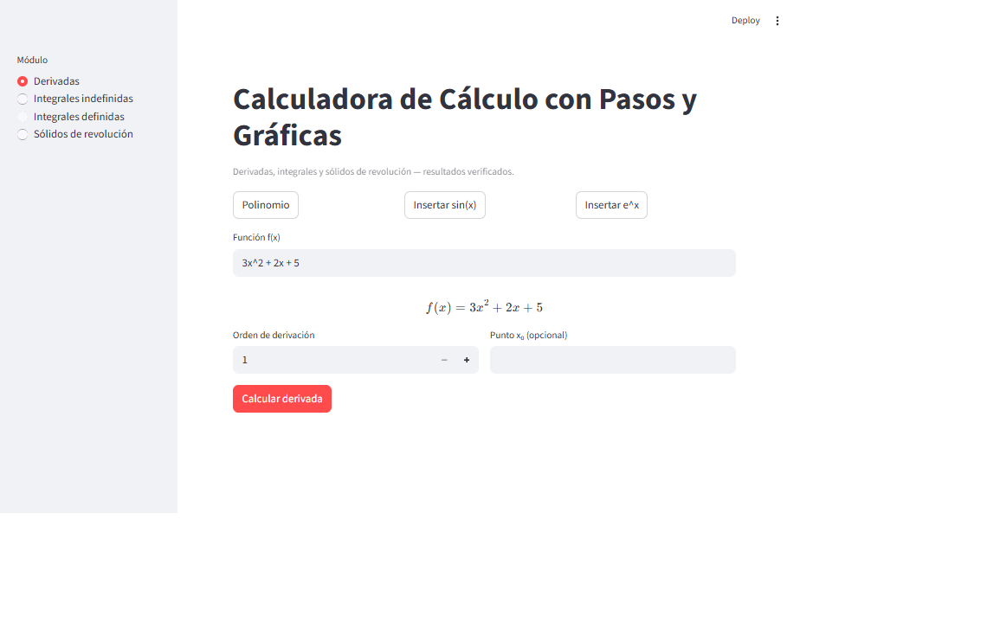
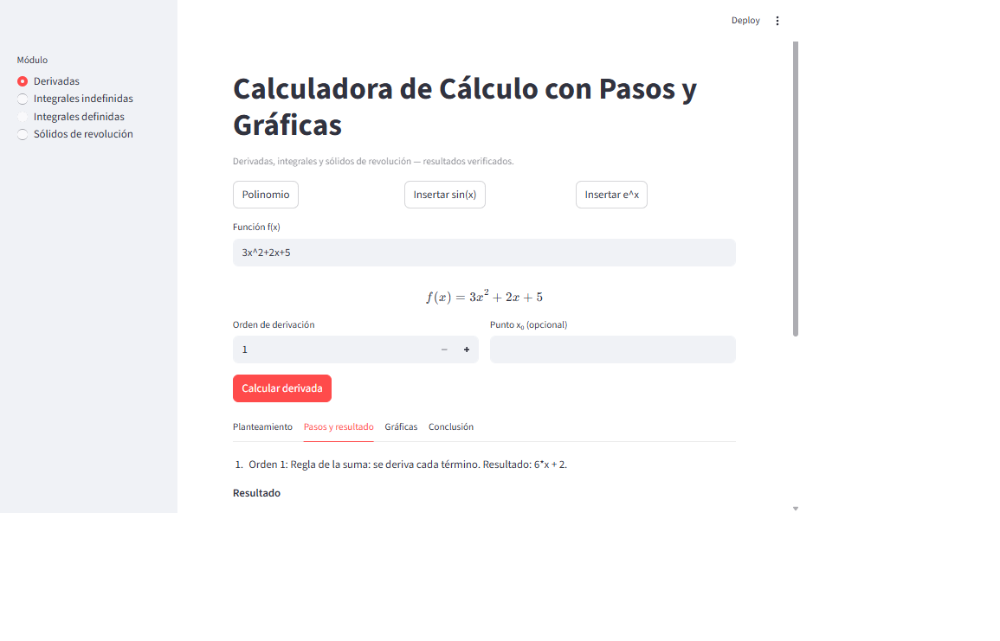
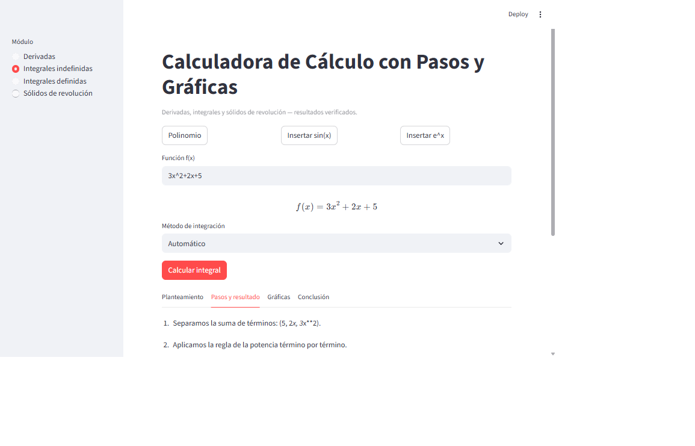
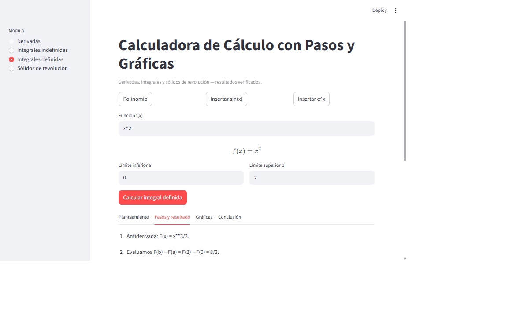
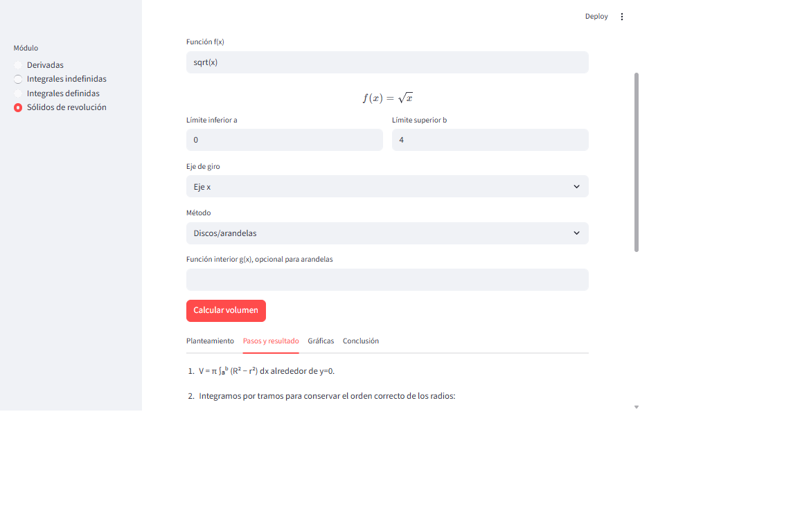
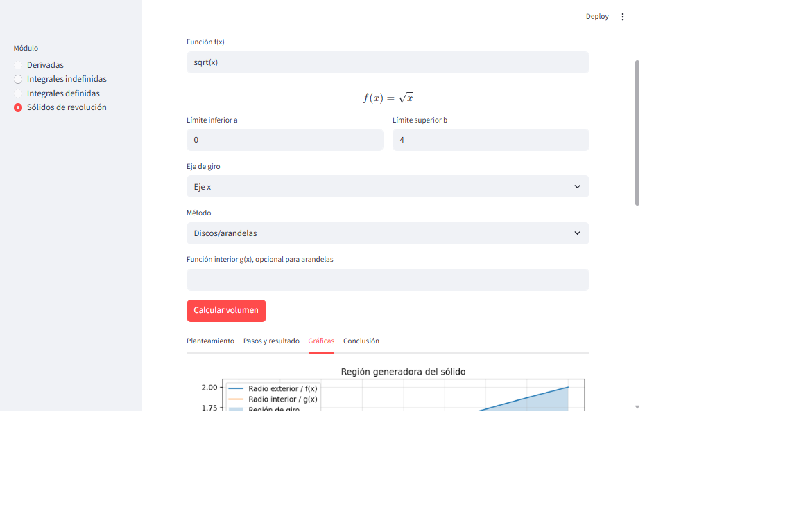

# Materiales públicos — Calculadora de Cálculo

La aplicación está disponible aquí:

**[Abrir Calculadora de Cálculo](https://calculadora-calculo-ii.onrender.com/)**

## Manual de usuario

[Descargar el manual de usuario (DOCX)](Manual_Usuario_Calculadora_Calculo_II_Publico.docx)

## Video demostrativo

- [Ver o descargar el video (MP4)](assets/demo-calculadora.mp4)
- [Ver recorrido animado (GIF)](assets/demo-calculadora.gif)

## Capturas

Este repositorio contiene exclusivamente el manual, el video y las capturas. El código fuente permanece en un repositorio privado.
